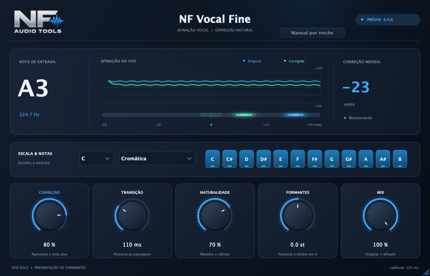
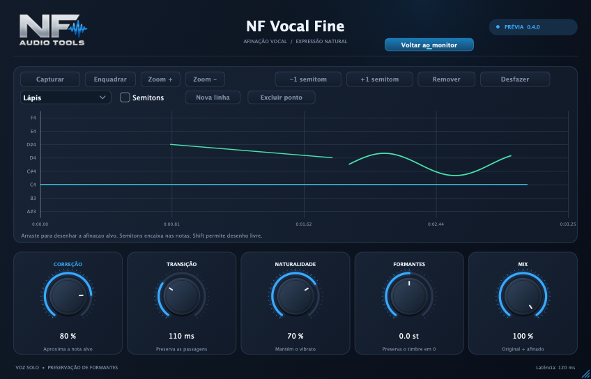
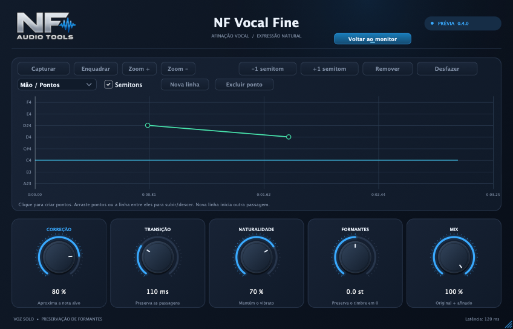
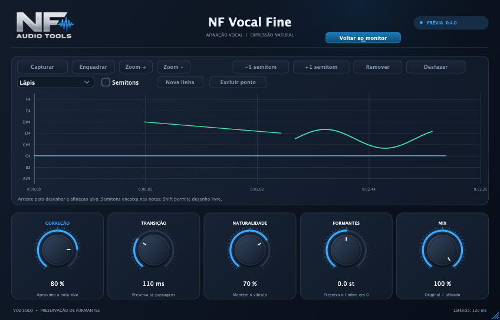

# NF Vocal Fine

Plugin de afinação vocal da **NF Audio Tools**, em VST3, com interface escura em azul e prata e o logo original da marca.



Imagem obtida com um sinal sintético de teste, mostrando as duas medições reais de afinação.

A versão **0.4.0** acrescenta **Mão / Pontos** e **Lápis** ao editor Manual. Crie pontos ligados por linhas ou desenhe a curva de afinação alvo. A edição é salva na sessão e aplicada ao áudio durante a reprodução, na posição do trecho escolhido.

## Ajustar uma nota específica

1. Abra **Manual por trecho** no cabeçalho.
2. Clique **Capturar** e reproduza o trecho vocal pela DAW. Pare a captura quando a passagem aparecer no mapa.
3. Clique em uma nota detectada para selecionar sua extensão, ou arraste um intervalo com o mouse.
4. Use **−1 semitom** ou **+1 semitom** e reproduza a passagem novamente.
5. Use **Remover** para devolver somente a seleção à afinação automática, ou **Desfazer** para restaurar a edição anterior.



O deslocamento manual é aplicado à voz original no intervalo escolhido, preservando suas pequenas variações; ele tem prioridade sobre a escala e a intensidade da correção automática nesse intervalo. Os demais trechos continuam usando os controles automáticos. Os cliques são cumulativos até ±12 semitons. Um ajuste manual de 0 st preserva a afinação original nesse intervalo; Remover restaura a afinação automática.

**Verde no mapa manual é o destino previsto**, não uma medição de áudio já renderizado. Para comparar as medições reais, volte ao monitor e reproduza. O gráfico manual, os intervalos e seus deslocamentos ficam salvos no estado do plugin. O botão do cabeçalho informa quando há ajustes manuais, mesmo ao voltar ao monitor.

### Mão / Pontos

Depois de capturar a voz, escolha **Mão / Pontos** na lista de ferramentas. Clique no gráfico para criar um ponto e clique em outra posição para criar o segundo: a linha entre eles define a altura alvo ao longo do tempo. Uma linha precisa de **pelo menos dois pontos** para afetar o áudio.

Arraste um ponto verticalmente para subir/descer a nota e horizontalmente para ajustar seu tempo. Os pontos não cruzam os vizinhos. Arraste a própria linha para mover juntos os dois pontos que a delimitam; um clique na linha acrescenta um novo ponto. **Semitons** encaixa nas notas cromáticas; desmarque ou segure **Shift** para ajuste contínuo. **Nova linha** começa uma passagem independente. **Excluir ponto** apaga o ponto selecionado; **Remover** apaga a linha ativa quando não há intervalo selecionado.



### Lápis

Escolha **Lápis** e arraste sobre o gráfico para desenhar a afinação desejada. A curva é aplicada ao soltar o mouse. Por padrão, o lápis desenha livremente; Semitons permite encaixar nas notas. Um clique em **Desfazer** remove o gesto inteiro.



O eixo vertical representa **altura de nota**, não volume ou formato de onda do timbre. Verde é a curva alvo prevista e azul é a voz capturada. A altura entre pontos é interpolada continuamente. Uma linha reta reduz as variações de afinação; desenhe as ondulações que deseja manter. Reproduza e volte ao monitor para conferir as medições reais. Use Mix 100% ao avaliar a afinação desenhada.

Curvas têm prioridade sobre os deslocamentos por intervalo, e a linha criada mais recentemente prevalece quando há sobreposição. **−1 / +1** e **Remover**, com um intervalo selecionado, substituem/recortam curvas somente nesse trecho, preservando as partes externas. O deslocamento de áudio é limitado a ±12 semitons em relação à voz detectada. O desenho não altera áudio quando não há pitch detectável.

As curvas e os pontos permanecem editáveis após salvar e reabrir a sessão. Limites: 64 linhas e 4096 pontos de curva, além dos limites de captura e intervalos descritos abaixo.

### Posição na DAW

A edição usa o tempo da sessão fornecido pelo host VST3. Ela é reaplicada ao voltar para a mesma posição e também na renderização quando o host fornece transporte/posição válidos. Sem essa informação, o modo manual aguarda a DAW e não aplica deslocamentos em posições inventadas. O transporte parado não aplica ajustes manuais à entrada ao vivo.

Os ajustes ficam ligados ao tempo da sessão, não à identidade de um clipe. Depois de mover um clipe ou mudar a montagem, confira e refaça os intervalos correspondentes. Capture apenas a passagem desejada; Enquadrar, Zoom +/− e a roda do mouse ajudam a navegar. A captura guarda metadados de afinação, não o áudio, com até 36 mil pontos e 128 intervalos de ajuste. O histórico local permite desfazer 64 alterações. Notas muito curtas e limites entre sílabas ainda exigem avaliação auditiva e ajuste da seleção.


## Primeiro teste

Use uma voz solo gravada, sem acompanhamento ou efeitos no mesmo arquivo. Escolha o tom e a escala da música. A configuração inicial é Correção 80%, Transição 110 ms, Naturalidade 70%, Formantes 0 st e Mix 100%.

O monitor compara duas medições reais de afinação: **azul = voz original** e **verde = saída corrigida**, incluindo a posição do controle Mix. O original é atrasado internamente pela latência do processamento para as duas curvas representarem o mesmo instante do áudio. O valor à direita mostra a diferença medida entre as duas vozes quando há nota detectada. A régua horizontal, de -50 a +50 cents, usa luzes neon nas mesmas cores e marca o zero no centro; o histórico acima mostra até ±100 cents em relação à nota mais próxima do original.

## Tamanho da interface

A abertura padrão é **848 × 544**, 20% menor em cada dimensão que a prévia 0.2.0. Arraste a alça azul no canto inferior direito para aumentar ou diminuir proporcionalmente, entre 636 × 408 e 1590 × 1020. **Dois cliques no logo NF** restauram o tamanho padrão. O redimensionamento do conteúdo preserva a escala de tela definida pelo host.

Os analisadores adicionais de afinação funcionam enquanto o editor está aberto e não modificam o sinal de áudio.

A prioridade desta prévia é avaliar a qualidade em voz gravada. A latência é de **120 ms**, informada ao host para compensação, e pode incomodar durante monitoração ao vivo. A naturalidade ainda depende de teste auditivo com voz real. Não é um afinador polifônico nem um editor manual de notas.

## Compilar

Requer CMake 3.22+, compilador C++17 e um checkout externo do JUCE 9. Signalsmith Stretch e Signalsmith Linear estão incluídos em `ThirdParty/` com suas licenças.

```sh
cmake -S . -B build -DCMAKE_BUILD_TYPE=Release -DJUCE_DIR=/caminho/para/JUCE
cmake --build build --target NFVocalFine_VST3 -j 6
```

No macOS, o bundle fica em `build/NFVocalFine_artefacts/Release/VST3/NF Vocal Fine.vst3`. Depois da geração de `moduleinfo.json`, aplique a assinatura local:

```sh
codesign --force --deep --sign - "build/NFVocalFine_artefacts/Release/VST3/NF Vocal Fine.vst3"
codesign --verify --deep --strict "build/NFVocalFine_artefacts/Release/VST3/NF Vocal Fine.vst3"
```

Copie o bundle para `~/Library/Audio/Plug-Ins/VST3/` e faça a DAW buscar plugins novamente. Esta prévia é assinada localmente e não é notarizada pela Apple. A compilação local entregue é para Mac Intel (x86_64); uma versão Apple Silicon ou Windows precisa de compilação e validação próprias.

Para evitar duas cópias da mesma prévia no host, retire o VST3 antigo NF Vocal Natural da pasta de busca ao instalar o NF Vocal Fine. Guarde-o como backup. A atualização mantém os IDs de parâmetros e o formato de estado; a compatibilidade completa de sessões antigas em cada DAW ainda precisa ser verificada.

## Testes

```sh
cmake -S . -B build -DNF_BUILD_TESTS=ON -DJUCE_DIR=/caminho/para/JUCE
cmake --build build --target VocalFineTests VocalFineEditorChecks VocalFineManualChecks VocalFineCurveChecks -j 6
build/VocalFineTests_artefacts/Release/VocalFineTests "$(pwd)/build/NFVocalFine_artefacts/Release/VST3/NF Vocal Fine.vst3"
build/VocalFineEditorChecks_artefacts/Release/VocalFineEditorChecks "$(pwd)/work/ui-checks"
build/VocalFineManualChecks_artefacts/Release/VocalFineManualChecks "$(pwd)/work/manual.png"
build/VocalFineCurveChecks_artefacts/Release/VocalFineCurveChecks "$(pwd)/work/curve-checks"
```

As verificações cobrem detecção de notas, áudio corrigido em 44,1/48/96 kHz, latência por impulso, estéreo, reset, vibrato, escalas, carregamento do VST3, parâmetros, persistência, abertura compacta no host, medições das curvas e ausência de mudanças no áudio ao ativar a monitoração. Os testes do editor exercitam a alça, os limites de tamanho, o duplo clique no logo, a escala de tela e o enquadramento dos controles. O host de teste é baseado em JUCE; isso não substitui o teste dentro da DAW do usuário.

## Organização

- `Source/Engine.h`: motor de áudio reutilizável.
- `Source/Plugin.cpp`: parâmetros, estado, wrapper e interface.
- `Source/FineLook.h`: desenho dos controles.
- `Source/Tests.cpp`: testes do motor e do VST3.
- `Source/EditorChecks.cpp`: testes de interação e imagens de verificação do editor.
- `Source/ManualModel.h` e `Source/ManualPanel.h`: captura, intervalos, estado e editor manual.
- `Source/ManualChecks.cpp`: seleção de trecho, deslocamento real de áudio, transporte e persistência.
- `Source/CurveChecks.cpp`: pontos, desenho livre, interpolação, áudio, gestos e persistência das curvas.
- `Assets/Logo.png`: logo original fornecido pelo usuário, incorporado ao binário.
- `ThirdParty/`: bibliotecas e termos de terceiros.

A integração nativa na Mixa Studio fica para depois da aprovação do VST3. Este projeto não altera a Mixa, não instala plugins automaticamente e não tem workflows de publicação.

## Dependências e identidade visual

O logo é da NF Audio Tools e não recebe a licença das bibliotecas de terceiros. JUCE é fornecido sob AGPLv3 ou licença comercial. Para distribuição fechada, pode ser necessária uma licença comercial aplicável do JUCE. Consulte `ThirdParty/JUCE-LICENSE.md` e os termos do JUCE antes de distribuir. Signalsmith Stretch e Linear mantêm suas licenças MIT incluídas nos respectivos diretórios.
